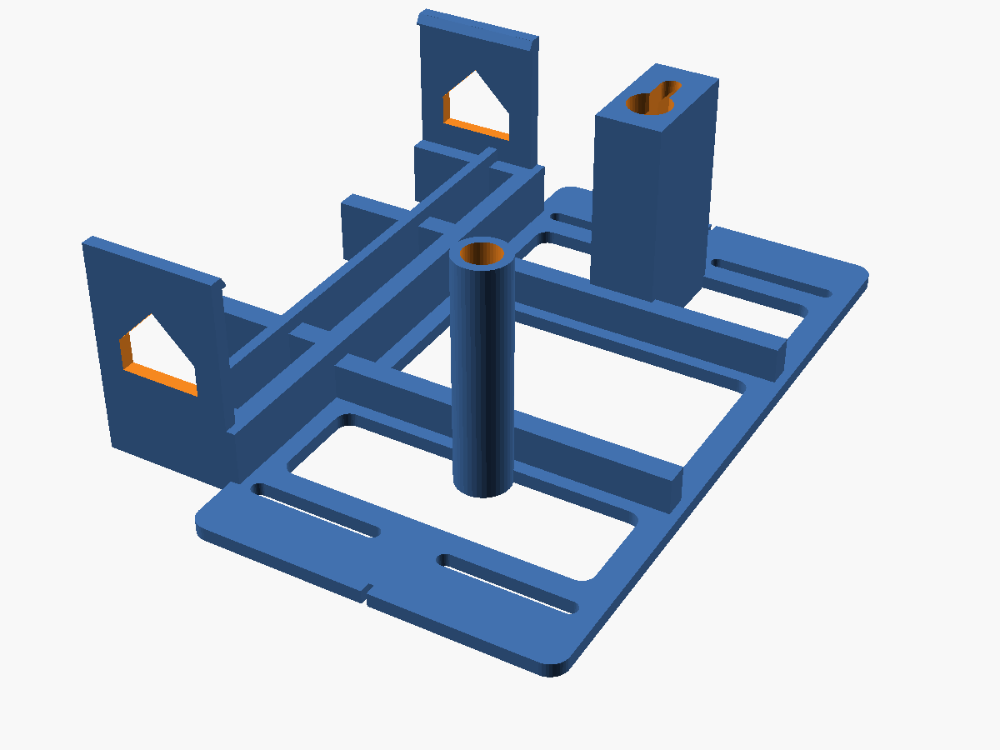

# Barre LED 4 × HUB75 — éclisses de jonction

4 panneaux P5 64 × 32 px (320 × 160 mm), alignés en paysage : barre de 1280 × 160 mm (256 × 32 px).
Jonctions à X = −320, 0 et +320 mm (origine au centre de la barre).

| Fichier | Quantité | Emplacement |
|---|---|---|
| `eclisse_simple.stl` | 1 | jonction X = −320, trou de serrure |
| `eclisse_simple_alim.stl` | 1 | jonction X = +320, trou de serrure + berceau d'alimentation côté −X |
| `eclisse_pi.stl` | 1 | jonction centrale X = 0, Pi Zero 2 WH clipsé + berceau d'alimentation côté +X |

Source paramétrique : `eclisse.scad` (OpenSCAD). Régénérer :

```sh
openscad -D 'variante="simple"'      -o eclisse_simple.stl      eclisse.scad
openscad -D 'variante="simple_alim"' -o eclisse_simple_alim.stl eclisse.scad
openscad -D 'variante="pi"'          -o eclisse_pi.stl          eclisse.scad
```





## Géométrie

Repère : X = 0 sur la jonction, Y = 0 à mi-hauteur (Y+ = haut de la barre accrochée),
Z = 0 sur la face contre le dos des panneaux.

- Plaque 80 × 150 × 3 mm, coins arrondis R4, ajourée en échelle (`allegement = false` pour une plaque pleine).
- 2 nervures 76 × 5 × 8 mm (Z 3 → 11), centrées à Y = ±25.
- 4 lumières M3 de 3,4 mm, centres d'arrondi de X = ±8 à ±34, à Y = ±60.
- Encoches repères 1,2 × 2,5 mm à X = 0, en haut et en bas.

### Raspberry Pi (éclisse centrale)

`pi_fixation = "clips"` (par défaut) :
- 4 plots Ø 6 × 5 mm à X = ±29, Y = ±11,5, surmontés de pions de centrage Ø 2,4 qui entrent dans les trous du Pi.
- 4 crochets souples sur les petits côtés du circuit, près des coins (à côté du lecteur micro-SD et du connecteur caméra).
  Le Pi s'enfonce tout droit et se clipse ; pour le retirer, écarter les crochets d'un côté.
- **Mesurer l'épaisseur du circuit** et régler `pcb_ep` (1,4 mm par défaut), sinon le Pi aura du jeu ou ne se clipsera pas.

`pi_fixation = "vis"` : retour aux trous borgnes Ø 2,2 pour vis autotaraudeuses M2,5 × 6.

### Alimentation

**Mean Well LRS-200-5** (5 V 40 A) — surtout pas la version 48 V : panneaux et Pi sont en 5 V.
4 panneaux × 18 W max = 72 W, soit 14,4 A ; la 200 W garde une large marge et chauffe peu.

- Boîtier 215 × 115 × 30 mm posé à plat entre l'éclisse Pi (X = 0) et l'éclisse X = +320,
  centré à X = +160 (au dos du 3ᵉ panneau), à 15 mm du dos des panneaux (`alim_z0`)
  pour passer au-dessus des connecteurs HUB75 et d'alimentation.
- Chaque éclisse porte un berceau qui reçoit une extrémité (17 mm de recouvrement) :
  repose sur le prolongement des nervures et sur un rebord le long des joues ;
  les joues reprennent le poids (barre au mur) et **clipsent** le dessus du boîtier.
  On pose l'alim en la poussant dans les deux berceaux depuis le côté mur.
- Une butée basse (3 mm) en bout de chaque berceau empêche le boîtier de glisser
  sans gêner les fils du bornier.
- **Sécurité** : le bornier reçoit le 230 V. Câbler avant de poser la barre, serrer la terre,
  et ne pas laisser de conducteur dénudé.

### Fixation murale

- `ecart_mur` est calculé à partir de l'alim : 15 + 30 + lèvres + 4 mm d'air ≈ **52 mm**
  entre le dos des panneaux et le mur. Tous les pieds font cette hauteur, le Pi passe largement.
- Pied du haut : boîtier creux 15 × 28 mm, avec **trou de serrure** sur les deux éclisses simples
  (Ø 10 pour la tête, fente 4,5 mm vers le haut). Vis murales Ø 4 à tête Ø 8–9, espacées de **640 mm**,
  tête à ~7 mm du mur.
- Pied du bas : simple colonne creuse Ø 12 qui maintient la barre parallèle au mur.
- `fixation_murale = false` retire les pieds.

## Visserie

- Éclisses → panneaux : 12 × M3 × 8 (tête bouton ISO 7380 ou cylindrique ISO 4762) + 12 rondelles larges DIN 9021.
- Mur : 2 vis Ø 4 + chevilles.
- Pi : aucune vis (clips).

## À vérifier avant impression

- Position des inserts M3 au dos des panneaux (Y = ±60, X = 8 → 34 supposés).
- Épaisseur du circuit du Pi (`pcb_ep`, 1,4 à 1,6 mm selon les sources : les deux passent).
- Dimensions de l'alim reçue (215 × 115 × 30 mm) et hauteur des connecteurs au dos des panneaux (`alim_z0`).

## Impression

À plat, Z = 0 sur le plateau (face lisse), sans support. PETG, 4 périmètres.
**Aucun pont.** Tout part du plateau ou monte en pente à 45° au plus :
- le creux du pied à trou de serrure se referme en toit en V à 45° ; la tête de la vis murale
  se cale contre les deux pentes, à ~6,5 mm de la face côté mur ;
- les fenêtres des joues des berceaux ont un sommet en pointe à 45° ;
- seuls restent les petits débords des lèvres de clipsage (0,8 mm pour le Pi, 1,6 mm pour l'alim),
  qui doivent être plats pour retenir et s'impriment sans support.
Volume : 35 cm³ (simple), 62 cm³ (simple + alim), 64 cm³ (Pi + alim). Hauteur d'impression : 52 mm.
