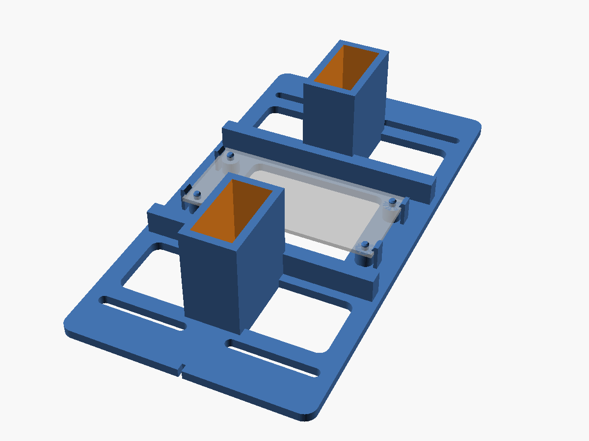

# Barre LED 4 × HUB75 — éclisses de jonction

4 panneaux P5 64 × 32 px (320 × 160 mm), alignés en paysage : barre de 1280 × 160 mm (256 × 32 px).
Jonctions à X = −320, 0 et +320 mm (origine au centre de la barre).

| Fichier | Quantité | Emplacement |
|---|---|---|
| `eclisse_simple.stl` | 2 | jonctions X = ±320, avec trou de serrure pour l'accrochage mural |
| `eclisse_pi.stl` | 1 | jonction centrale X = 0, Raspberry Pi Zero 2 WH clipsé |

Source paramétrique : `eclisse.scad` (OpenSCAD). Régénérer :

```sh
openscad -D 'variante="simple"' -o eclisse_simple.stl eclisse.scad
openscad -D 'variante="pi"'     -o eclisse_pi.stl     eclisse.scad
```




## Géométrie

Repère : X = 0 sur la jonction, Y = 0 à mi-hauteur (Y+ = haut de la barre accrochée),
Z = 0 sur la face contre le dos des panneaux.

- Plaque 80 × 150 × 3 mm, coins arrondis R4, ajourée en échelle (`allegement = false` pour une plaque pleine).
- 2 nervures 76 × 5 × 8 mm (Z 3 → 11), centrées à Y = ±25.
- 4 lumières M3 de 3,4 mm, centres d'arrondi de X = ±8 à ±34, à Y = ±60.
- Encoches repères 1,2 × 2,5 mm à X = 0, en haut et en bas.

### Raspberry Pi (éclisse centrale)

`pi_fixation = "clips"` (par défaut) :
- 4 plots Ø 6 × 5 mm à X = ±29, Y = ±11,5, surmontés de pions de centrage Ø 2,4 qui entrent dans les trous du Pi.
- 4 crochets souples sur les petits côtés du circuit, près des coins (à côté du lecteur micro-SD et du connecteur caméra).
  Le Pi s'enfonce tout droit et se clipse ; pour le retirer, écarter les crochets d'un côté.
- **Mesurer l'épaisseur du circuit** et régler `pcb_ep` (1,4 mm par défaut), sinon le Pi aura du jeu ou ne se clipsera pas.

`pi_fixation = "vis"` : retour aux trous borgnes Ø 2,2 pour vis autotaraudeuses M2,5 × 6.

### Fixation murale

- Chaque éclisse porte 2 pieds creux de 35 mm (`ecart_mur`) qui tiennent la barre écartée du mur
  et laissent la place au Pi, à la carte HUB75 et aux nappes.
- Sur les 2 éclisses simples, le pied du haut a un **trou de serrure** : Ø 10 pour la tête, fente de 4,5 mm vers le haut.
  Vis murales Ø 4 à tête Ø 8–9 (vis à bois + cheville), espacées de **640 mm** à l'horizontale, tête à ~5 mm du mur.
- L'éclisse Pi a 2 pieds sans trou de serrure : ils empêchent la barre de fléchir au milieu.
- `fixation_murale = false` retire les pieds.

## Visserie

- Éclisses → panneaux : 12 × M3 × 8 (tête bouton ISO 7380 ou cylindrique ISO 4762) + 12 rondelles larges DIN 9021.
- Mur : 2 vis Ø 4 + chevilles.

## À vérifier avant impression

- Position des inserts M3 au dos des panneaux (Y = ±60, X = 8 → 34 supposés).
- Épaisseur du circuit du Pi (`pcb_ep`).

## Impression

À plat, Z = 0 sur le plateau (face lisse), sans support. PETG, 4 périmètres.
Seul le toit du pied à trou de serrure fait un pont de 13 mm, ce que le PETG passe sans support.
Volume : 38,4 cm³ (simple) et 41,0 cm³ (Pi), dont ~15 cm³ pour les pieds muraux.
