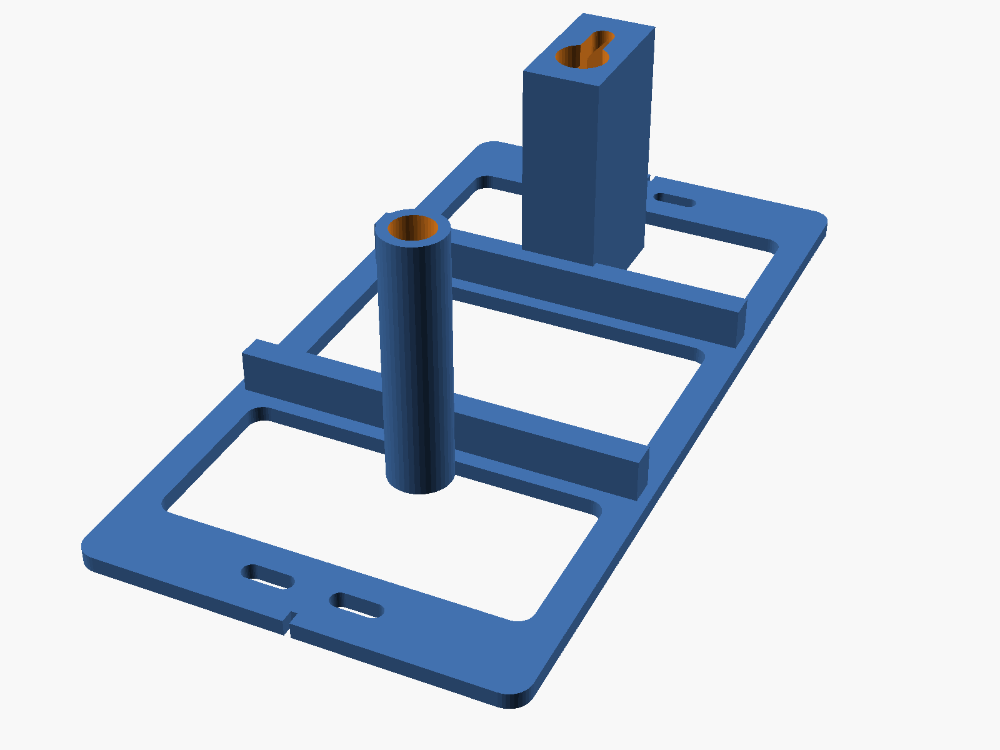

# Barre LED 4 × HUB75 — éclisses de jonction

4 panneaux P5 64 × 32 px (320 × 160 mm), alignés en paysage : barre de 1280 × 160 mm (256 × 32 px).
Jonctions à X = −320, 0 et +320 mm (origine au centre de la barre).

| Fichier | Quantité | Emplacement |
|---|---|---|
| `eclisse_simple.stl` | 1 | jonction X = −320, trou de serrure |
| `eclisse_simple_alim.stl` | 1 | jonction X = +320, trou de serrure + berceau d'alimentation côté −X |
| `eclisse_pi.stl` | 1 | jonction centrale X = 0, Pi Zero 2 WH clipsé + berceau d'alimentation côté +X |

Source paramétrique : `eclisse.scad` (OpenSCAD). Régénérer :

```sh
openscad -D 'variante="simple"'      -o eclisse_simple.stl      eclisse.scad
openscad -D 'variante="simple_alim"' -o eclisse_simple_alim.stl eclisse.scad
openscad -D 'variante="pi"'          -o eclisse_pi.stl          eclisse.scad
```




## Géométrie

Repère : X = 0 sur la jonction, Y = 0 à mi-hauteur (Y+ = haut de la barre accrochée),
Z = 0 sur la face contre le dos des panneaux.

- Plaque 80 × 156 × 3 mm, coins arrondis R4, ajourée en échelle (`allegement = false` pour une plaque pleine).
- 2 nervures 76 × 5 × 8 mm (Z 3 → 11), centrées à Y = ±25.
- 4 lumières M3 de 3,4 mm centrées sur les inserts mesurés : X = ±8 (réglage ±3 mm), Y = ±70.
  Panneaux YS-P5-320X160-16S : inserts aux coins à 8 mm du bord, entraxe vertical 140 mm.
- Encoches repères 1,2 × 2,5 mm à X = 0, en haut et en bas.

### Raspberry Pi (éclisse centrale)

`pi_fixation = "clips"` (par défaut) :
- 4 plots Ø 6 × 5 mm à X = ±29, Y = ±11,5, surmontés de pions de centrage Ø 2,4 qui entrent dans les trous du Pi.
- 4 crochets souples sur les petits côtés du circuit, près des coins (à côté du lecteur micro-SD et du connecteur caméra).
  Le Pi s'enfonce tout droit et se clipse ; pour le retirer, écarter les crochets d'un côté.
- **Mesurer l'épaisseur du circuit** et régler `pcb_ep` (1,4 mm par défaut), sinon le Pi aura du jeu ou ne se clipsera pas.

`pi_fixation = "vis"` : retour aux trous borgnes Ø 2,2 pour vis autotaraudeuses M2,5 × 6.

### Alimentation

**Mean Well LRS-200-5** (5 V 40 A, boîtier n° 207 : 215 × 115 × 30 mm).

- Posée à plat entre l'éclisse Pi (X = 0) et l'éclisse X = +320, centrée à X = +160,
  à 15 mm du dos des panneaux (`alim_z0`) pour passer au-dessus de leurs connecteurs.
- **Vissée** dans ses taraudages M4 latéraux (plan Mean Well : 2 par grand côté, à 32,5 mm de chaque bout,
  12,5 mm du dessous, vis ≤ 5 mm dans le boîtier) : 4 vis **M4 × 8 + rondelle**
  (ou M4 × 6 sans rondelle). Trous oblongs ±1,5 mm pour rattraper l'entraxe des éclisses.
- Chaque berceau est réduit au strict nécessaire : un cadre bas de 8 mm (2 longerons + 2 traverses)
  et, de chaque côté, un pilier de 15,5 mm de large qui reçoit la vis M4, monte jusqu'au mur
  (pied d'écartement) et est contreventé par un gousset à 45°. Le boîtier ne repose sur rien,
  il est tenu par ses 4 vis.
- **Sécurité** : le bornier reçoit le 230 V. Câbler avant de poser la barre, serrer la terre,
  sélecteur d'entrée sur 230 V.

### Fixation murale

- `ecart_mur` = 15 + 30 + 4 mm d'air = **49 mm** entre le dos des panneaux et le mur.
- Éclisse X = −320 : pied à trou de serrure en haut + colonne creuse Ø 12 en bas.
- Éclisse X = +320 : pied à trou de serrure ; les piliers du berceau font l'appui.
- Éclisse Pi : pas de pied, les piliers de son berceau s'appuient contre le mur.
- Trous de serrure : Ø 10 pour la tête, fente 4,5 mm vers le haut. Vis murales Ø 4 à tête Ø 8–9,
  espacées de **640 mm**, tête à ~7 mm du mur.

## Visserie

- Éclisses → panneaux : 12 × M3 × 8 (tête bouton ISO 7380 ou cylindrique ISO 4762) + 12 rondelles larges DIN 9021.
- Alimentation : 4 × M4 × 8 + 4 rondelles M4 (ou 4 × M4 × 6 sans rondelle) — jamais plus de 5 mm dans le boîtier.
- Mur : 2 vis Ø 4 + chevilles.
- Pi : aucune vis (clips).

## À vérifier avant impression

- Épaisseur du circuit du Pi (`pcb_ep`, 1,4 à 1,6 mm selon les sources : les deux passent).
- Hauteur des connecteurs au dos des panneaux (`alim_z0`).

## Impression

À plat, Z = 0 sur le plateau (face lisse), sans support. PETG, 4 périmètres.
**Aucun pont.** Tout part du plateau ou monte en pente à 45° au plus :
- le creux du pied à trou de serrure se referme en toit en V à 45° ; la tête de la vis murale
  se cale contre les deux pentes, à ~6,5 mm de la face côté mur ;
- les trous M4 des piliers sont en goutte, les goussets en pente à 45° ;
- seuls restent les débords de 0,8 mm des lèvres des clips du Pi et le haut plat de 3 mm des trous oblongs M4.
Volume : 33 cm³ (simple), 43 cm³ (simple + alim), 38 cm³ (Pi + alim). Hauteur d'impression : 49 mm.
