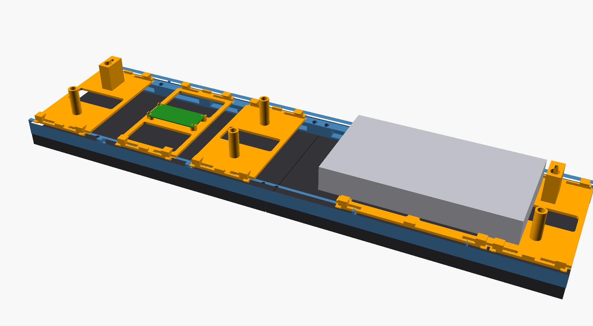
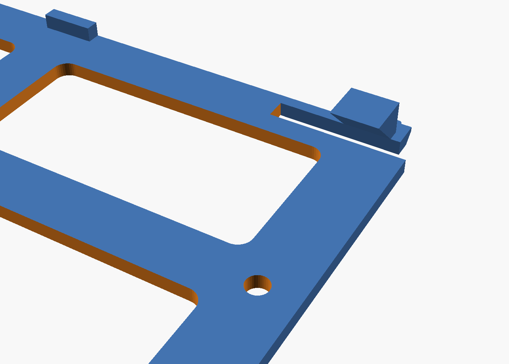
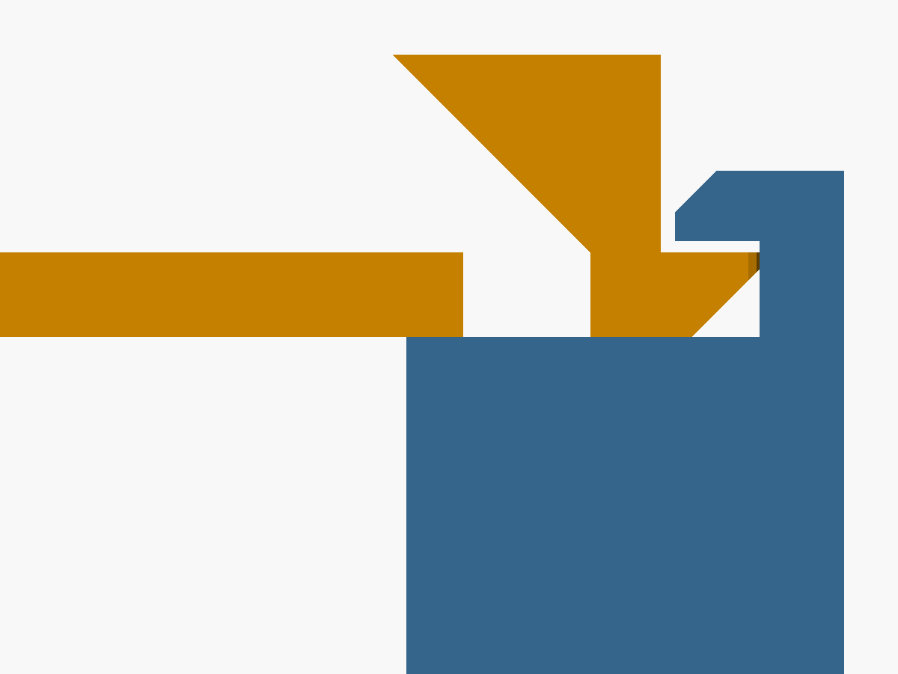

# Glissières modulaires (remplacent les éclisses)

Source : `../glissiere.scad` (`-D 'piece="…"'`). STL déjà orientés pour l'impression,
**aucun support**, tout tient dans 25 × 25 cm.

## Principe

- Deux rails continus, haut et bas, vissés dans les inserts M3 des panneaux (Y = ±70).
  Le tronçon de jonction (2 vis, à ±8 de la jonction) relie aussi les panneaux entre eux.
- Les chariots se **clipsent sans outil** grâce à **4 clips souples** (2 par rail, aux coins) :
  on les pose et on appuie, les crochets passent sous les rebords des rails. Un cran tous les
  10 mm les maintient en place ; on peut les faire glisser à la main. Pour décliper : tirer
  les languettes d'un côté vers le centre et soulever.
- Deux **butées rigides** au milieu de chaque chariot s'appuient contre le nez des rebords :
  ce sont elles qui portent le poids quand la barre est au mur, pas les clips.

- Le dessous des chariots est à **14 mm** de la face des inserts (connecteurs : 8 mm).
- Écart dos des panneaux → mur : 51 mm (alimentation + 4 mm d'air).

## Quantités

| Pièce | Rôle | 2 panneaux | 4 panneaux |
|---|---|---|---|
| `rail_jonction` (200 mm) | à cheval sur chaque jonction, haut et bas | 2 | 6 |
| `rail_milieu` (120 mm) | milieu de chaque panneau, haut et bas | 4 | 8 |
| `rail_bout` (100 mm) | les 4 coins (pièce symétrique) | 4 | 4 |
| `cle` | clavette entre deux tronçons | 8 | 16 |
| `chariot_pi` | Raspberry Pi Zero 2 W clipsé | 1 | 1 |
| `chariot_alim` | Mean Well LRS-200-5 | 1 | 1 |
| `chariot_mural` | pied à trou de serrure + colonne | 2 | 2 |
| `chariot_appui` | 2 colonnes d'appui (facultatif, contre la flexion) | 0 | 1–2 |

Les rails haut et bas sont la même pièce, tournée de 180°, bouts compris (le 2e lamage
et la 2e clavette du bout restent inutilisés). On peut se contenter des rails
de jonction et des rails de milieu des panneaux qui portent un chariot.

## Visserie

- Rails → panneaux : **M3 × 8** (4 + 8 + 4 = 24 vis pour 4 panneaux). Tête logée dans un lamage, accessible
  par le dessus avant de poser les chariots.
- Alimentation → chariot : **4 × M4 × 6 sans rondelle**, par-dessous, dans les taraudages du dessous
  du boîtier (entraxe 150 × 50 ; jamais plus de 3 mm dans le boîtier). À visser avant de clipser le chariot.
- Mur : vis Ø 4 à tête Ø 8–9 + chevilles, tête à ~7 mm du mur ; les chariots muraux glissent
  pour s'aligner sur les vis.

## Impression

- Rails : couchés sur leur face extérieure (gorge vers le haut), comme dans le STL.
- Chariots : plateau sur le plateau d'impression.
- PETG, couche 0,28, 3 périmètres, remplissage 15 %, supports désactivés.
